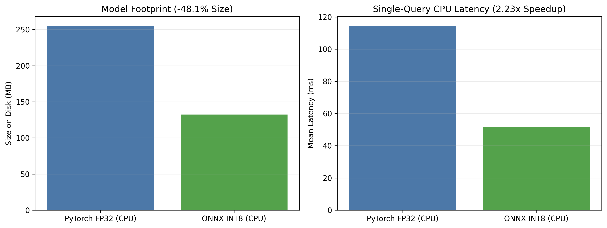

# J.U.D.E. — Local-First Two-Tier Desktop AI Assistant

[](https://colab.research.google.com/github/Baymax005/JUDE/blob/main/colab/train_tier1_router.ipynb)

**J.U.D.E.** is a local-first, voice-and-screen-aware Windows desktop assistant built on a **two-tier cognitive cascade**, separating sub-20 ms deterministic intent routing from lazy-loaded local LLM reasoning.

---

## Two-Tier Architecture

| Tier | Engine | Role | Latency Target |
| :--- | :--- | :--- | :--- |
| **Tier 1 (System 1 — Fast Reflex)** | Fine-tuned `distilbert-base-uncased` (INT8 ONNX via `onnxruntime`) + deterministic Python handlers | Classifies intent locally and executes fast commands directly (`SAVE_MEMORY`, `RECALL_MEMORY`, `OPEN_TARGET`, `COMPRESS_FILES`, `SYSTEM_INFO`) | ~10–15 ms on CPU |
| **Tier 2 (System 2 — Deliberate Reasoning)** | Local `qwen2.5-coder:1.5b` wrapped as custom Ollama model `jude` (`keep_alive="3m"`) | Lazy-loaded only for generative writing, open Word document edits, screen error explanation, web search summarization, and general Q&A | ~1–3 s local |

### 3-Way Confidence Gate + Temperature Scaling
Tier 1 calibrated softmax probabilities drive a 3-way routing gate configured in [`app/config.py`](app/config.py):

- **`confidence >= 0.80`** → **Direct Route**: Execute Tier 1 Python handler immediately (or route directly to the Tier 2 handler for generative intents).
- **`0.55 <= confidence < 0.80`** → **Confirm / Clarify**: Prompt for quick user confirmation before running file or system actions.
- **`confidence < 0.55`** → **Escalate / Fallback**: Treat as out-of-distribution or ambiguous and hand off safely to Tier 2 (`jude`) or request clarification.

---

## Intent Taxonomy & Datasets

### 1. In-Distribution Intent Dataset ([`colab/intents_dataset.csv`](colab/intents_dataset.csv))
**1,080 synthetic utterances** (`9` balanced intents × `120` utterances each), mixing clean `typed` queries (~70/class) and `voice` ASR-style transcripts (~50/class), plus semantic paraphrases and cross-class hard negatives:

| Intent | Tier | Scope |
| :--- | :--- | :--- |
| `SAVE_MEMORY` | `tier1` | Store synthetic notes, reminders, schedules, and preferences in local SQLite |
| `RECALL_MEMORY` | `tier1` | Retrieve previously saved notes, contacts, or reminders |
| `OPEN_TARGET` | `tier1` | Open local folders, files, or desktop applications |
| `COMPRESS_FILES` | `tier1` | Zip, archive, or bundle files and folders into `.zip` archives |
| `SYSTEM_INFO` | `tier1` | Query local drive space, RAM/CPU usage, battery level, time/date, or network status |
| `EDIT_DOCUMENT` | `tier2` | Rewrite, shorten, polish, fix grammar, or insert content in an open Word document / selection |
| `EXPLAIN_SCREEN` | `tier2` | Read and explain visible errors, stack traces, dialogs, or code currently on screen |
| `WEB_SEARCH` | `tier2` | Search the web (`ddgs` + `trafilatura`) and summarize retrieved pages |
| `GENERAL_CHAT` | `tier2` | General Q&A, conceptual explanations, standalone drafting, and conversation |

> **Privacy Note:** All dataset utterances in `colab/` are synthetic placeholders. Personal user memory (`data/memory.db`), caches, models, and logs are gitignored and remain strictly local.

### 2. Out-of-Distribution & Ambiguity Test Set ([`colab/ood_test_utterances.csv`](colab/ood_test_utterances.csv))
**30 unseen OOD utterances** (`10` `asr_noise`, `10` `unsupported_action`, `10` `ambiguous`) used strictly during evaluation to validate the 3-way confidence gate and temperature scaling calibration.

---

## Training Tier 1 on Google Colab

1. Click the **Open in Colab** badge above (or open [`train_tier1_router.ipynb`](https://colab.research.google.com/github/Baymax005/JUDE/blob/main/colab/train_tier1_router.ipynb)).
2. Select **Runtime → Change runtime type → T4 GPU**.
3. Click **Runtime → Run all**.

### Evaluation & Report Outputs Produced
The notebook runs on a reproducible stratified **80% / 10% / 10%** split (`SEED = 42`) and outputs:
- **Baseline vs. DistilBERT Comparison (`baseline_vs_distilbert.csv`):** Tuned **TF-IDF + Logistic Regression** baseline vs. fine-tuned **`distilbert-base-uncased`** on the exact same split.
- **Full Per-Class Metrics:** Precision, Recall, and F1-Score (`classification_report`) plus `confusion_matrix.png`.
- **Training Dynamics:** `loss_curve.png` (Training vs. Validation Loss + Validation Accuracy & Macro-F1 per epoch).
- **Calibration & OOD Validation:** Temperature scaling (`T` fitted on validation NLL), ECE before/after scaling, 3-way gate breakdown on ID vs. OOD queries (`ood_predictions.csv`), and `confidence_histogram_ood.png`.
- **FP32 PyTorch vs. INT8 ONNX Benchmark (`fp32_vs_int8_benchmark.png`):** Model size (MB), single-query CPU latency (mean/p50/p95 ms), and test accuracy/Macro-F1.
- **Downloadable Archives:**
  - `tier1_router_bundle.zip` (`model_quantized.onnx`, `tokenizer.json`, `tokenizer_config.json`, `label_map.json`, `metrics.json`)
  - `cl461_report_assets.zip` (all PNG charts, CSV tables, and `metrics.json`)

After downloading `tier1_router_bundle.zip`, extract its contents into `models/tier1_router/`.

---

## Evaluation & Benchmark Results

All classification metrics below were measured on the held-out stratified **10% test split (`n = 108`, `SEED = 42`)** and the unseen **OOD / ambiguity test set (`n = 30`)**. Local hardware measurements were captured on a **Local 6-Core x86-64 CPU** and **Local 4 GB VRAM CUDA GPU**.

### 1. Intent Classification (`n = 108` Held-Out Test Split)

| Model | Test Accuracy | Macro Precision | Macro Recall | Macro-F1 | Typed Acc | Voice Acc |
| :--- | :---: | :---: | :---: | :---: | :---: | :---: |
| **TF-IDF + Logistic Regression (`C=5.0`)** | `99.07%` | `0.9915` | `0.9907` | `0.9907` | `98.44%` | `100.00%` |
| **Fine-Tuned DistilBERT (FP32, best epoch 3)** | `98.15%` | `0.9829` | `0.9815` | `0.9814` | `98.44%` | `97.73%` |
| **INT8 ONNX DistilBERT (CPU runtime)** | `96.30%` | — | — | `0.9632` | — | — |

> While a tuned linear baseline matches DistilBERT within a single sample on clean in-vocabulary test queries, DistilBERT provides contextual subword generalization on unseen paraphrases and clean probability separation for OOD gating.

### 2. Calibration & 3-Way Confidence Gate (`n = 108` ID + `n = 30` OOD)

| Metric | Measured Value |
| :--- | :---: |
| **ID Direct-Route Accuracy (`confidence >= 0.80`)** | **`100.00%`** |
| **OOD Blocked from Direct Execution (`confidence < 0.80`)** | **`96.7%`** (`29 / 30`) |
| **OOD Auto-Escalated to Tier 2 (`confidence < 0.55`)** | **`53.3%`** (`16 / 30` escalated, `13 / 30` confirm) |
| **ID vs. OOD ROC-AUC (Max Softmax)** | **`0.9469`** |
| **Validation ECE (`T = 1.0`)** | `0.1045` |

### 3. Tier 1 Footprint & CPU Inference Latency

| Runtime | Footprint | Mean Latency | P50 Latency | P95 Latency |
| :--- | :---: | :---: | :---: | :---: |
| **PyTorch FP32 (Colab 2-vCPU)** | `255.45 MB` | `114.56 ms` | `91.72 ms` | `229.71 ms` |
| **ONNX INT8 (Colab 2-vCPU)** | `132.47 MB` (`-48.14%`) | `51.49 ms` | `44.05 ms` | `100.72 ms` |
| **ONNX INT8 (Local 6-Core x86-64 CPU, `threads=4`)** | `132.47 MB` | **`6.61 ms`** | **`6.58 ms`** | **`8.81 ms`** |

*Running Tier 1 on `CPUExecutionProvider` keeps the runtime free of multi-GB CUDA dependencies and leaves 100% of GPU VRAM available for Tier 2.*

### 4. Tier 2 Local `jude` (1.5B) GPU vs. CPU Inference

| Execution Mode | VRAM Used | Generation Speed | Generation Latency | Total Latency |
| :--- | :---: | :---: | :---: | :---: |
| **Local 6-Core x86-64 CPU (`num_gpu=0`)** | `0.0 / 1118.8 MB` | `19.23 tok/s` | `1153.4 ms` | `1239.6 ms` |
| **Local 4 GB VRAM CUDA GPU (`num_gpu=99`)** | `1115.2 / 1115.2 MB` | **`24.11 tok/s`** (`1.25x`) | **`912.4 ms`** | **`970.0 ms`** |

*Tier 1 (`6.61 ms` mean) resolves deterministic commands ~147× faster than waking Tier 2 (`970.0 ms` total on GPU).*

### Training & Evaluation Charts

| Training vs. Validation Loss | Test Set Confusion Matrix |
| :---: | :---: |
|  |  |

| Confidence Calibration & OOD Gate | FP32 PyTorch vs. INT8 ONNX |
| :---: | :---: |
|  |  |

---

## Portable Local Setup & Verification

`run_jude.ps1`, `launch_jude.vbs` (silent zero-terminal launch), and `launch_jude.bat` keep virtual environments, caches, temporary files, SQLite memory, backups, and Ollama model paths self-contained inside the project folder:

```powershell
# Launch the floating Baymax desktop widget (or double-click launch_jude.vbs / launch_jude.bat)
.\run_jude.ps1

# Verify environment isolation + Tier 1 ONNX router
.\run_jude.ps1 -m app.main --check

# Run a single command in CLI mode
.\run_jude.ps1 -m app.main --once "What time is it?"

# Verify full environment, imports, and local Ollama 'jude' model
.\run_jude.ps1 .\verify_env.py

# Run Phase 2 automated test suite
.\run_jude.ps1 .\tests\test_phase2.py
```

---

## Floating Baymax Desktop Widget & Safety Controls

- **Pure PySide6 `QPainter` Avatar (`0 MB` external images):** Renders a HiDPI glossy porcelain-white capsule head (`●—●`) with periodic eye blinking, smooth floating bob, and color-coded status ring (`IDLE` cyan, `Tier 1` emerald, `Tier 2` violet rotating arc, `Confirm` amber, `Speaking` sky-blue, `Error` red).
- **Expandable HUD & Tray Controls:** Click Baymax to expand/collapse the chat HUD, drag to reposition anywhere on screen, or toggle **Voice On / Muted** (local Windows SAPI5 `pyttsx3`) from the dock pill, HUD header, or system tray menu.
- **Safety-by-Design Confirmation Gate:** File compression (`COMPRESS_FILES`), Word document edits (`EDIT_DOCUMENT` with editable before/after diff preview + timestamped snapshots saved to `backups/`), and medium-confidence (`0.55–0.80`) Tier 1 actions always pause for explicit confirmation before modifying anything.

---

## Phase 3 CI/CD Packaging Note (`.exe` Builds)

When building Windows desktop releases via GitHub Actions (`.github/workflows/build-exe.yml`), J.U.D.E. will be packaged using **PyInstaller `--onedir`** (distributed as a release `.zip`) rather than `--onefile`. Using `--onedir` keeps runtime artifacts self-contained and avoids unpacking `_MEI*` temporary folders at runtime.
